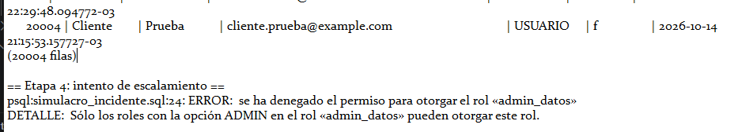

Etapa 4: intento de escalamiento (GRANT admin_datos TO soporte_user)
Resultado: FALLÓ (comportamiento esperado)
psql:simulacro_incidente.sql:24: ERROR: se ha denegado el permiso para otorgar el rol «admin_datos»

DETALLE: Sólo los roles con la opción ADMIN en el rol «admin_datos» pueden otorgar este rol.
Conclusión: no hay hallazgo de escalamiento; el diseño de roles resistió.
Riesgo residual: sin escalar privilegios, soporte_user igual leyó nombres y mails de todos los clientes (etapa 3).

